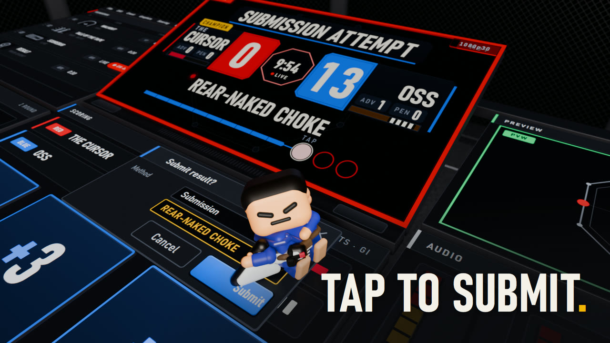

# editor-ia-starter-kit

Edita videos cortos con Claude Code. Español primero; [English below](#english).



*"Tap to Submit", a 12 s BJJ character film made with the kit.*

## Español

### Qué es

Un kit de inicio para editar videos cortos (Reels, Shorts) con Claude Code.
Dejas el material en `inbox/`, hablas con el agente, y el video final sale en
`outbox/`. El kit tiene dos caminos:

- **Edición de videos cortos con HyperFrames (el núcleo).** El agente corta tu
  grabación, diseña los gráficos en movimiento y los subtítulos, y renderiza.
- **Película 3D de personaje (opcional, pesada).** Un personaje de juguete arma
  un gráfico en movimiento sobre una app gigante, renderizado en Blender. La
  imagen de arriba es de "Tap to Submit", una película de 12 s sobre BJJ hecha
  con el kit. El núcleo no necesita ninguna herramienta de este camino.

### Requisitos

Núcleo (obligatorio):

| Herramienta | Para qué |
| --- | --- |
| [Claude Code](https://claude.com/claude-code), en la app de escritorio de Claude | El agente que edita |
| [Node 22 o más nuevo](https://nodejs.org) | Los scripts del kit y HyperFrames |
| [FFmpeg](https://ffmpeg.org/download.html) con ffprobe, en el PATH | Cortar, medir y codificar |
| [Chrome](https://www.google.com/chrome/) o Chromium | HyperFrames lo usa para renderizar |
| [whisper.cpp](https://github.com/ggml-org/whisper.cpp/releases) o una clave de [ElevenLabs](https://elevenlabs.io) | Transcribir tu voz |

whisper.cpp transcribe gratis en tu máquina. En Windows descarga
`whisper-blas-bin-x64.zip` de la versión v1.8.3 (la probada con este kit; las
versiones más nuevas no traen binarios para Windows), descomprime y agrega
`Release` al PATH, o apunta `HYPERFRAMES_WHISPER_PATH` al `whisper-cli.exe`.
En Mac: `brew install whisper-cpp`. En Linux: compílalo según su README
(`cmake -B build && cmake --build build -j --config Release`, el binario queda
en `build/bin/whisper-cli`) o instala el paquete de tu distribución si lo tiene.

Película 3D (opcional):

| Herramienta | Para qué |
| --- | --- |
| [Blender 5.x](https://www.blender.org/download/) | Construye y renderiza la escena con Cycles |
| Una [GPU que Cycles soporte](https://docs.blender.org/manual/en/latest/render/cycles/gpu_rendering.html): NVIDIA (OptiX o CUDA), AMD (HIP), Apple Silicon (Metal) o Intel Arc (oneAPI) | El render. En la CPU es muchas veces más lento |
| [Python 3.10 o más nuevo](https://www.python.org/downloads/) | El sonido sintetizado y las medidas, en `.venv` |
| Disco libre | Unos 5 GB por película |

### Instalar

```bash
npm install
npm run setup
npx hyperframes doctor
```

`npm run setup` revisa cada herramienta y te dice qué falta. Si no tienes
`.env`, lo crea desde `.env.example`. Llena una clave solo si vas a usar ese
servicio (ElevenLabs para voz y efectos, Kie.ai para música y clips generados).
Sin ninguna clave el kit funciona completo: transcripción local con Whisper y
gráficos en movimiento diseñados por el agente.

Luego abre Claude Code en esta carpeta y escribe `/onboard` una vez. Lee antes
`docs/ONBOARDING.md` (5 minutos).

Película 3D, solo si la quieres:

1. Instala Blender 5.x.
2. `npm run film:install` crea `.venv` con Python 3.10+ e instala numpy, scipy,
   pedalboard y Pillow. No instala Blender ni Chrome.
3. `npm run setup -- --film` revisa todo. Cada línea `FAIL` dice cómo
   arreglarla. Detalles en `docs/SETUP.md`, "Film path".

### Usar

1. Deja tu grabación en `inbox/`.
2. Abre Claude Code en esta carpeta y escribe `/new-video`.
3. Elige **guiado** (el camino conocido, con revisiones en cada paso) o
   **libre** (sin guion, tú diriges).
4. Elige la marca. La primera vez, el agente copia `brands/_template/` y te
   pide colores y fuentes.
5. Revisa cada borrador cuando el agente te lo pida.
6. Recoge el video, la portada, el texto y los subtítulos en `outbox/<proyecto>/`.

### Carpetas

| Carpeta | Qué hay |
| --- | --- |
| `inbox/` | Todo lo que entra. Sin orden. |
| `video-projects/` | Trabajo en curso, un proyecto por carpeta con fecha. |
| `outbox/` | Solo finales: video, portada, texto, subtítulos. |
| `brands/` | Una carpeta por cliente: colores, fuentes, logo, reglas. |
| `styles/` | Estilos de edición copiados de videos que te gustan. |
| `.claude/skills/` | Las habilidades del agente. |
| `docs/` | El manual de edición y las guías. |

### Ajustes

`kit.config.json`:

- `language`: idioma en que te habla el agente. `es` por defecto.
- `models.profile`: `solo` (un agente Opus 5.5 hace todo) o `team` (Opus dirige y
  diseña, Haiku 5.5 hace el trabajo mecánico en paralelo, más barato).
- `models.engineer`: solo para la película 3D. Ver "Película 3D: lo que cuesta".
- `transcription.languages`: idioma de tus grabaciones, `["es"]`, `["en"]` o las dos.
- `transcription.provider`: `whisper` (local, gratis) o `elevenlabs`.
- `defaults`: tamaño del video y marca por defecto.
- `outbox`: qué es obligatorio entregar.

### Copiar el estilo de un video que te gusta

Descarga el video a `inbox/` y di: "quiero editar como este video". El agente lo
mide con ffmpeg, escribe las reglas en `styles/drafts/<nombre>/` con la evidencia
de cada regla, y te ofrece una prueba de 3 segundos. Si te gusta, lo mueves a
`styles/core/`.

### Película 3D: lo que cuesta

Di "quiero una película 3D" y el agente usa la habilidad `character-film`.
`npm run new-video -- <slug> --kind film` revisa la máquina antes de crear el
proyecto y se detiene si falta algo.

Medido en una sola máquina (RTX 5070 Ti), con "Tap to Submit". Tu máquina dará
otros números.

- Render: 12 s a 1080p en 681 s (16:9) y 672 s (9:16).
- Disco: la carpeta del proyecto llegó a 5,2 GB.
- Rondas de revisión: de 2 a 3,5 horas cada una, con los renders. La película
  llevó 4 rondas y un pase de pulido.
- Modelos: Opus 5.5 toma cada decisión de gusto. El modelo ingeniero
  (`models.engineer` en `kit.config.json`, Fable 5.1 por defecto) escribe el
  código del motor. Si tu plan no incluye Fable, pon `models.engineer` en
  `claude-opus-5-5`.

### Lo que el kit nunca hace

- Publicar, subir o postear. El final se queda en `outbox/`.
- Hacer una llamada a una API de pago sin tu sí en el chat.

### Problemas frecuentes

- **`new-video` se niega dentro de un git worktree.** `video-projects/` y
  `outbox/` están fuera de Git, así que al borrar el worktree se borra el
  proyecto. Trabaja en la copia principal del kit; el mensaje la nombra.
  `--allow-worktree` crea el proyecto igual, y el proyecto sigue atado al worktree.
- **Una carpeta de proyecto no se deja mover.** En Windows, un proceso que sigue
  abierto la bloquea. `npm run unlock -- <id>` lista esos procesos y
  `npm run unlock -- <id> --stop` los detiene.
- **No hay GPU para la película 3D.** `CYCLES_DEVICE=CPU` renderiza en la CPU.
  Es muy lento, y solo pasa si tú lo pides.

### Créditos y licencias

El kit parte de un kit de edición con licencia MIT (ver `LICENSE` y el permiso
de uso en `licenses/`) y de
[HyperFrames](https://github.com/heygen-com/hyperframes) de HeyGen (Apache-2.0).
El método para copiar estilos toma ideas de [REA](https://github.com/morluto/rea)
(MIT). El formato de la película 3D sale del análisis del paquete de prompts
"No After Effects" de Clawd Motion Lab y del artículo
["Motion Engineering: Build a Video Studio Around Opus 5.5"](https://x.com/0xwhrrari/status/2105643919119696297)
de @0xwhrrari. Ver `LICENSE`, `THIRD_PARTY_NOTICES.md` y `licenses/`.

---

## English

### What it is

A starter kit for short-form video editing (Reels, Shorts) with Claude Code.
Drop footage in `inbox/`, talk to the agent, and pick up the final video in
`outbox/`. The kit has two paths:

- **Short-form editing with HyperFrames (the core).** The agent cuts your
  recording, designs the motion graphics and the captions, and renders.
- **3D character film (optional, heavy).** A toy hero builds a motion graphic
  on a giant software UI, rendered in Blender. The image above is from "Tap to
  Submit", a 12 s BJJ film made with the kit. The core needs none of this
  path's tools.

### Requirements

Core (required):

| Tool | What for |
| --- | --- |
| [Claude Code](https://claude.com/claude-code), in the Claude desktop app | The agent that edits |
| [Node 22 or newer](https://nodejs.org) | The kit's scripts and HyperFrames |
| [FFmpeg](https://ffmpeg.org/download.html) with ffprobe, on PATH | Cut, measure and encode |
| [Chrome](https://www.google.com/chrome/) or Chromium | HyperFrames renders with it |
| [whisper.cpp](https://github.com/ggml-org/whisper.cpp/releases) or an [ElevenLabs](https://elevenlabs.io) key | Transcribe your voice |

whisper.cpp transcribes for free on your machine. On Windows, download
`whisper-blas-bin-x64.zip` from release v1.8.3 (the one tested with this kit;
the newest releases ship no Windows binaries), unzip it and add `Release` to
PATH, or point `HYPERFRAMES_WHISPER_PATH` at `whisper-cli.exe`. On a Mac:
`brew install whisper-cpp`. On Linux: build it from source per its README
(`cmake -B build && cmake --build build -j --config Release`; the binary lands
in `build/bin/whisper-cli`), or install your distro's package if it has one.

3D character film (optional):

| Tool | What for |
| --- | --- |
| [Blender 5.x](https://www.blender.org/download/) | Builds and renders the scene with Cycles |
| A [GPU that Cycles supports](https://docs.blender.org/manual/en/latest/render/cycles/gpu_rendering.html): NVIDIA (OptiX or CUDA), AMD (HIP), Apple Silicon (Metal) or Intel Arc (oneAPI) | The render. On the CPU it is many times slower |
| [Python 3.10 or newer](https://www.python.org/downloads/) | Synthesized sound and measurements, in `.venv` |
| Free disk | About 5 GB per film |

### Install

```bash
npm install
npm run setup
npx hyperframes doctor
```

`npm run setup` checks each tool and tells you what is missing. When `.env` is
missing, it creates it from `.env.example`. Fill a key only for a service you
use (ElevenLabs for voice and effects, Kie.ai for music and generated clips).
With no key at all the kit works in full: local Whisper transcription and
motion graphics that the agent designs.

Then open Claude Code in this folder and type `/onboard` once. Read
`docs/ONBOARDING.md` first (5 minutes).

3D character film, only if you want it:

1. Install Blender 5.x.
2. `npm run film:install` creates `.venv` with Python 3.10+ and installs numpy,
   scipy, pedalboard and Pillow. It does not install Blender or Chrome.
3. `npm run setup -- --film` checks everything. Each `FAIL` line tells you how
   to fix it. Details in `docs/SETUP.md`, "Film path".

### Use

1. Put your recording in `inbox/`.
2. Open Claude Code in this folder and type `/new-video`.
3. Choose **guided** (the known path, with a review at each step) or
   **freeform** (no script, you direct).
4. Choose the brand. The first time, the agent copies `brands/_template/` and
   asks for colors and fonts.
5. Review each draft when the agent asks.
6. Collect the video, cover, caption and subtitles in `outbox/<project>/`.

### Folders

| Folder | What it holds |
| --- | --- |
| `inbox/` | Everything that comes in. Unsorted. |
| `video-projects/` | Work in progress, one dated folder per project. |
| `outbox/` | Finals only: video, cover, caption, subtitles. |
| `brands/` | One folder per client: colors, fonts, logo, rules. |
| `styles/` | Editing styles copied from videos you like. |
| `.claude/skills/` | The agent's skills. |
| `docs/` | The editing playbook and the guides. |

### Settings

`kit.config.json`:

- `language`: the language the agent speaks to you. `es` by default.
- `models.profile`: `solo` (one Opus 5.5 agent does everything) or `team` (Opus
  directs and designs, Haiku 5.5 does the mechanical work in parallel, cheaper).
- `models.engineer`: only for the 3D film. See "3D character film: what it takes".
- `transcription.languages`: the language of your footage, `["es"]`, `["en"]` or both.
- `transcription.provider`: `whisper` (local, free) or `elevenlabs`.
- `defaults`: video size and default brand.
- `outbox`: what every delivery must contain.

### Copy the style of a video you like

Download the video to `inbox/` and say "edit like this video". The agent
measures it with ffmpeg, writes the rules to `styles/drafts/<name>/` with the
evidence for each rule, and offers a 3-second test. If you like it, move it to
`styles/core/`.

### 3D character film: what it takes

Say "make a 3D film" and the agent uses the `character-film` skill.
`npm run new-video -- <slug> --kind film` checks the machine before it creates
the project, and stops when something is missing.

Measured on one machine (RTX 5070 Ti), with "Tap to Submit". Your machine will
give other numbers.

- Render: 12 s at 1080p in 681 s (16:9) and 672 s (9:16).
- Disk: the project folder reached 5.2 GB.
- Review rounds: 2 to 3.5 hours each, renders included. The film took 4 rounds
  and a polish pass.
- Models: Opus 5.5 makes every taste decision. The engineer model
  (`models.engineer` in `kit.config.json`, Fable 5.1 by default) writes the
  engine code. If your plan has no Fable, set `models.engineer` to
  `claude-opus-5-5`.

### What the kit never does

- Publish, upload or post. The final stays in `outbox/`.
- Make a paid API call without your yes in chat.

### Troubleshooting

- **`new-video` refuses inside a git worktree.** `video-projects/` and
  `outbox/` are outside Git, so removing the worktree deletes the project. Work
  in the main checkout of the kit; the message names it. `--allow-worktree`
  creates the project anyway, and the project stays tied to the worktree.
- **A project folder will not move.** On Windows, a process that is still
  running locks it. `npm run unlock -- <id>` lists those processes, and
  `npm run unlock -- <id> --stop` stops them.
- **No GPU for the 3D film.** `CYCLES_DEVICE=CPU` renders on the CPU. It is very
  slow, and it happens only when you ask for it.

### Credits and licenses

Built on an MIT-licensed editing kit (see `LICENSE` and the use permission in
`licenses/`) and
[HyperFrames](https://github.com/heygen-com/hyperframes) by HeyGen (Apache-2.0).
The reverse-engineering method borrows from [REA](https://github.com/morluto/rea)
(MIT). The 3D character film format was reverse-engineered from the
"No After Effects" prompt pack by Clawd Motion Lab and the article
["Motion Engineering: Build a Video Studio Around Opus 5.5"](https://x.com/0xwhrrari/status/2105643919119696297)
by @0xwhrrari. See `LICENSE`, `THIRD_PARTY_NOTICES.md` and `licenses/`.
