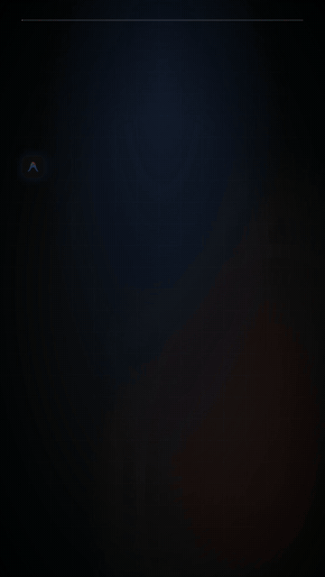

# editor-ia-starter-kit-gemini

Edita videos cortos (Reels, Shorts) con Gemini, dentro de Google Antigravity.
Dejas tus clips en `inbox/`, hablas con el agente, y el video final sale en
`outbox/`. [English below](#english).

Este repo es un espejo de
[editor-ia-starter-kit](https://github.com/ziccarelli369/editor-ia-starter-kit)
(la versión para Claude Code). Se genera con un script; ver `MIRROR.txt`.

## Empezar: dos prompts

[](docs/tutorial/tutorial-instalacion-video.mp4)

[Ver el tutorial con sonido](docs/tutorial/tutorial-instalacion-video.mp4).

Necesitas [Antigravity](https://antigravity.google/download), la app de Google
donde Gemini puede ejecutar programas en tu PC. Entra con tu cuenta de Google.
El chat normal de Gemini no sirve: no puede cortar video.

**1. Instalar.** Abre Antigravity y pega esto en el chat:

```text
Instala este kit de edición de video en mi PC: https://github.com/ziccarelli369/editor-ia-starter-kit-gemini
Clónalo en mi carpeta Documentos. Entra en la carpeta y ejecuta npm install y luego node scripts/setup.mjs. Si falta Git, Node 22, FFmpeg o Chrome, dime cuál falta y pídeme permiso antes de instalarlo. Al terminar, dime la ruta de la carpeta.
```

Cuando termine, añade esa carpeta a Antigravity como proyecto. Así el agente
lee las reglas del kit.

**2. Pedir el reel.** En el proyecto del kit, pega esto con la ruta de tus clips:

```text
Hazme un reel de Instagram con el footage de C:\Videos\mis-clips
```

El agente copia tus clips, te hace unas preguntas y te enseña cada versión.
Te pide un sí antes de poner texto en pantalla y antes de dar una versión por
final. El video y la portada quedan en `outbox/<proyecto>/`.

Para la música, copia a la carpeta `music/` una canción que tengas derecho a
usar (mp3 o wav). Una canción de Spotify no vale. Sin canción, el reel usa el
sonido de los clips.

Cuando Antigravity pida permiso para ejecutar `git`, `node`, `npm`, `npx` o
`ffmpeg`, acepta: son las herramientas del kit.

## Lo que el kit nunca hace

- Publicar, subir o postear. El final se queda en `outbox/`.
- Llamar a un servicio de pago sin tu sí en el chat.

## Modo experto (opcional)

Nada de esto hace falta para el primer reel. Cada punto está en
[docs/EXPERTO.md](docs/EXPERTO.md):

- **Subtítulos de voz**: whisper.cpp (gratis) o ElevenLabs.
- **ElevenLabs**: voz, efectos de sonido y transcripción medida. Por clave o por MCP.
- **Kie.ai**: música y clips generados.
- **Película 3D con Blender**: un personaje de juguete arma el video.
- **Copiar el estilo de un video que te gusta.**

## Carpetas

| Carpeta | Qué hay |
| --- | --- |
| `inbox/` | Todo lo que entra. Sin orden. |
| `video-projects/` | Trabajo en curso, un proyecto por carpeta. |
| `staging/` | Versiones de revisión (v1, v2…) para comparar. |
| `outbox/` | Solo finales: video, portada, texto, subtítulos. |
| `brands/` | Una carpeta por marca: colores, fuentes, logo. |
| `music/` | Tus canciones con licencia. |
| `.agents/skills/` | Las habilidades del agente. |
| `docs/` | El manual de edición y las guías. |

## Créditos y licencias

Espejo de editor-ia-starter-kit, que parte de un kit de edición con licencia
MIT (ver `LICENSE` y el permiso de uso en `licenses/`) y de
[HyperFrames](https://github.com/heygen-com/hyperframes) de HeyGen (Apache-2.0).
Ver `LICENSE`, `THIRD_PARTY_NOTICES.md` y `licenses/`. Los archivos Python de
`.agents/skills/film-engine/` usan la licencia GPL-3.0-or-later.

---

## English

Short-form video editing (Reels, Shorts) with Gemini inside Google Antigravity.
This repo is a generated mirror of
[editor-ia-starter-kit](https://github.com/ziccarelli369/editor-ia-starter-kit),
the Claude Code version; see `MIRROR.txt`.

1. Install [Antigravity](https://antigravity.google/download) and sign in with Google.
2. Paste the first prompt above in its chat: it clones this repo, runs
   `npm install` and checks the machine.
3. Add the cloned folder to Antigravity as a project.
4. Paste the second prompt with the path to your clips. Finals land in
   `outbox/<project>/`.

Optional paths (voice captions, ElevenLabs, Kie.ai, the Blender 3D film) are in
[docs/EXPERTO.md](docs/EXPERTO.md). Licenses: `LICENSE`,
`THIRD_PARTY_NOTICES.md`, `licenses/`.
